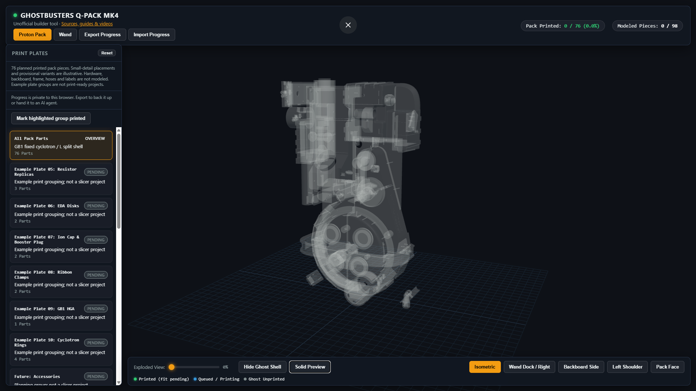

# Q-Pack Build Visualizer

An unofficial interactive 3D assembly and printing-progress viewer for a
Ghostbusters Q-Pack MK4 proton pack and wand.

**[Open the live viewer](https://pestoforce.github.io/q-pack-build-visualizer/)**

[](https://pestoforce.github.io/q-pack-build-visualizer/)

## Video preview

[](https://www.youtube.com/watch?v=SobxEf9ONpw)

**[Watch the video on YouTube](https://www.youtube.com/watch?v=SobxEf9ONpw)** to see the visualizer in action.
GitHub READMEs do not support embedded YouTube players; the thumbnail opens the video.

Viewer software is **MIT licensed**. Bundled Q-Pack model assets are
**CC BY-NC-SA 4.0**, not MIT: attribution, noncommercial use, and ShareAlike
restrictions apply. See [ATTRIBUTION.md](ATTRIBUTION.md).

## Using the viewer

Switch between **Proton Pack** and **Wand**, orbit/zoom with the mouse, and select a
part to inspect it. Plate cards highlight example groups. Empty-canvas clicks
deselect. Camera presets, an exploded slider, ghost visibility, and **Solid
Preview** help inspect the assembly.

**Assembled wand render** opens a finished-appearance reference with neutral prop
finishes rather than progress colors. The translucent tube in the interactive
wand is a separate, non-printed acrylic reference; it does not earn print credit
and hides during exploded view. Its nominal size is 7/8-inch OD by 6 inches long.
Insertion depth is illustrative and the inside diameter is not modeled.

**Assembled pack render** opens the 76-piece pack in black painted finishes with
metal-look fittings, a blue-lit powercell appearance and red cyclotron windows.
Blue depicts the visible light/backing, not a requirement for blue lens material;
a lit pack can use a clear/frosted diffuser with blue LEDs behind it.
This is an appearance reference, not a claim that parts are printed or assembled.
Small-detail positions and finishes remain illustrative; hoses, ribbon cable,
labels, backboard, straps and frame are not modeled.

Select a part and change its **Build status**, or select a specific group and use
**Mark highlighted group printed**. Group completion requires confirmation and
does not downgrade fit-checked, assembled, or finished pieces.

Progress starts blank and saves **only in your browser**; it is not uploaded to
GitHub or synced between devices. **Export Progress** downloads `progress.json`
for backups or AI-agent edits. **Import Progress** validates and replaces browser
progress after confirmation. Export before importing to avoid losing changes.
To start over, import the repository's blank `progress.json`.

Statuses: `pending`, `sliced`, `printing`, `printed`, `fit_checked`, `assembled`,
`finished`, `needs_rework`. Green means printed or a later stage, **not** an
automatic fit/assembly approval. Counts include only the **120 modeled pieces**,
not the entire physical build. Failed/rework pieces do not earn print credit.

## Tracking your build with an AI agent

Clone the repository, then tell your coding assistant to read **[AGENTS.md](AGENTS.md)**.
The agent can edit your exported `progress.json` using stable part IDs in
`assets/pack-parts.json` and `assets/wand-parts.json`.

Example prompts:

> Read AGENTS.md. I printed both upper and both lower cyclotron window rings.
> Update my exported progress.json to printed; keep fit checks pending.

> Read AGENTS.md. The rear electrical box is printed and visually looks good.
> Update only that wand piece, not its cover plate.

> Read AGENTS.md. My selected example plate is only partially successful.
> Help identify the successful pieces before updating progress.

The hosted viewer **cannot read an agent's local files automatically**. Export,
give the JSON file to your agent, then import the edited file. When serving a clone,
`progress.json` provides initial progress, but an existing browser save takes
precedence; import the edited file explicitly. Browser changes do not write to disk.
Do not commit private build notes, guides, receipts, addresses, or credentials.

## Run locally

No build step, runtime npm install, or backend is required. Serve the repository
over HTTP rather than opening `index.html` as a file.

```powershell
py -3 -m http.server 8080
```

On macOS/Linux use `python3 -m http.server 8080`. Open <http://localhost:8080/>.
Internet access is currently required for the pinned Three.js CDN scripts.
No analytics or account sign-in is included; CDNs receive ordinary asset requests.

## Sources and guides

| Resource | Original source |
|---|---|
| Printable Q-Pack files | [mr-kiou/q-pack, MK4 branch](https://github.com/mr-kiou/q-pack/tree/MK4) |
| Official MK4 assembly guide (paid, separate purchase) | [Creator's Etsy listing](https://www.etsy.com/listing/1554836449/) |
| Creative Geekery companion resources | [Ghostbusters build resource page](https://www.creativegeekery.com/ghostbusters) |
| Creative Geekery build overview | [Step-by-step guide article](https://www.creativegeekery.com/post/build-your-own-3d-printed-ghostbusters-proton-pack-free-step-by-step-guide) |
| Video 1: printing and assembly | [How to Build a Ghostbusters Proton Pack with 3D Printing (Step-by-Step)](https://www.youtube.com/watch?v=rL9p1oH5JjU) |
| Video 2: optional electronics | [DIY Ghostbusters Proton Pack Electronics (Complete Wiring Guide)](https://www.youtube.com/watch?v=7nHxTb9JlGo) |
| Video 3: weathering | [How I Weathered My Ghostbusters Proton Pack (Full DIY Build Guide)](https://www.youtube.com/watch?v=X9b56DHAqb8) |
| Video creator | [Creative Geekery YouTube channel](https://www.youtube.com/@Creative-Geekery) |
| Q-Pack community linked upstream | [3D Printed Ghostbusters Props Facebook group](https://www.facebook.com/groups/3DprintedGBprops) |

Use the creators' pages for current downloads and support. PDFs and videos are
not included here. Guide references are **PDF page numbers**, which differ from
the guide's printed numbering. Electronics are optional and not represented.

## Model coverage and limitations

Pack: **76 nominal printed pieces**, GB1 fixed cyclotron/bumper and actual L split
shell sections. Wand: **44 planned printed pieces**, including separate indicator
covers, hidden retaining plugs, both banjo bodies and their decorative screws.
The extra pieces receive their own stable IDs, status controls, and exploded offsets.
Existing 22-piece progress exports remain compatible; newly modeled pieces start pending.
Major shell offsets are registered to mating screw patterns. The HGA mounts on
the right gearbox side using its matching screw axis; the powercell lens covers
the front aperture, injector flange and EDA disks match their screw holes, and
the crank knob faces forward. A mounting-hole audit found that the split top
shell's print-layout coordinates needed a common(-7.955,+10.863,0)mm offset
relative to the assembled center covers, native ion arm and V-hook. Dependent
details now follow that registration. The tube retains its original untilted
pose: both underside screw axes match the corrected booster box. This
supersedes the earlier attempt to tilt the tube into rim-plane coincidence.
The PPD hangs straight down beneath the shoulder,parallel to the pack's long
axis. Its angled recessed end follows the slope and its flat end faces down;
it does not project along the shoulder normal. Its cylinder axis matches the
31.75mm cutout in booster box01 and both13mm-pitch side screw axes determine
insertion depth. There is more than3mm Y-envelope clearance to the beamline,
which remains on its matching center-cover screw hole. Both frame screw axes
match the tube's127.75mm pattern; its saddle clears the original tube surface.
The injector block's three screw axes match SynchGen04, with the flange seated
against the shell rather than60mm away along the bolts. The valve flange is
centered on the Clippard base; its42.9vs43.0mm pitch difference is retained
without scaling (about0.050mm residual per outer hole).

`scripts/pack-mounting-constraints.json` records119source-local bore-segment
constraints across57part relationships, including existing shell seams,
cyclotron quarters, center-cover joints, injector bracket, ion-arm cap and
resistor mounts. `npm run validate` checks their radial residuals, axis angles
and recorded axial separations. The audit screened all76pack meshes and fitted
553planar circular boundaries and503cylindrical surfaces (366 inward bores);
these counts include counterbores and repeated segments, not distinct screws.
Coaxiality is not proof of correct insertion depth or physical printed fit.
The second clamp, bumper/Alice spacers, PH25, shockmount and accessory drilling
sites without established mating features remain provisional. The original
tube-rim/shoulder angular discrepancy is retained rather than breaking the
measured screw relationships. No source geometry was resized.
The three Legris elbow/nut pairs are grouped at the HGA, cyclotron and ion-arm
underside. Each nut is seated on its corresponding elbow rather than positioned
independently. The ion-arm Legris axis follows its modeled socket; HGA and
cyclotron drilling positions remain illustrative. The HGA fittings' long stems
face the pack front, with compression outlet and Clippard barb bending downward.
Their shoulders sit on the front cylinder wall, superseding an earlier top-socket
assumption. These are not verified HGA mounting holes or drilling templates.
The Dale RH-50 mounts on the ion-arm side, with the original resistor and shell
hole pitches preserved (about 0.187 mm residual per hole, not a drilling template).
The separate short 25W resistor (`Sage_RH_25`) mounts vertically on the outer
ion-arm step beside the antenna/booster frame, with yellow tubing toward the
underside Legris. Its screw pair is centered without scaling (about 0.073 mm
residual per hole); it is not the long blue-tubed RH-50.
The Adaptaflex represents a provisional lower-right conduit entry only: its exact
variant and installation site are unverified. Tubing relationships are described
in the [GBFans tubing reference](https://www.gbfans.com/wiki/equipment/proton-pack/tubing);
the [Dale reference](https://www.gbfans.com/wiki/equipment/proton-pack/dale-resistors)
identifies the RH-50's ion-arm location. These cosmetic replicas are not working
pressure fittings.
### Assembly-diagram reconciliation

The GB1 pack and wand assembly diagrams were compared against the STL-derived
geometry. The wand-hose panel now slides into the generator dovetail instead of
remaining at its source layout's 60mm separation. Both wand banjos hang from
the negative-X side of the front assembly: one on the barrel's front outer ear,
the other on the metal tip's lug, matching the red-hose pair in prop references.
Neither is mounted on the rear tube, rear box or grip's rear ear.
The rear-ear transverse screw retains the ear; the rear-tube long stud is a
different hose fitting. Hose routing is not modeled.

Both left dials now have a large base and an eccentric small cap: **two copies of
each source file are required**, not one. Existing progress IDs keep their
meaning; `left_big_knob_2` and `left_small_knob_2` are separate new pieces that
start pending, including when importing older progress. The rear box and cover
are registered to the body screws and rear face; the rear hose nut, small right
knob and heat sink are seated on their matching features.
`scripts/wand-mounting-constraints.json` adds28source-local axis/seating checks.
The red Slo-Blo lens occupies the 5mm opening on the rear electrical box top,
beside the hose fitting. Both openings on the main body's sloped panel are left
clear for switches. Earlier placement on that panel or the front ledge was
incorrect. This relocates an existing pending cover, not an extra part.
The orange body indicator is on the lower ledge ahead of the front knob,
not in the upper Clippard opening. Its supplied 10mm body/12mm flange cannot
pass through the ledge's 6mm LED opening, so the preview shows exterior base
contact only, not a verified inside-mounted push fit. Confirm mounting before
assembly; the preview does not authorize drilling or resizing.
The front knurled knob sits on the upper vertical tier atX-25/Z72.333mm,
beside the wand valve location. The lower face'sX-18.5/Z22.22mm opening matches
the internal front-grip connector's M3 fixing axis; it is not a knob mounting
site. The existing `front_tube` is the black cylinder projecting forward from
that lower face, not an internal barrel core. Its end seats atY61.5mm and it
extends toY103.5mm onX-18.5/Z22.22mm. A separate three-piece R701 wand Clippard
mounts beside the upper knob; its flange holes match the body's42.9mm pitch.
The pack retains its R331 valve; each copy has independent progress.
The finger-grooved front grip projects sideways from the barrel, not underneath
it. Its plain screw end faces the rear ear; its angled screw end faces the front
ear. The rear face seats atY101.19mm. Native geometry leaves approximately0.197mm
front screw-axis residual and up to0.284mm sampled saddle/barrel overlap;
these are retained and flagged for physical dry-fit, not hidden by scaling.
The geometry is not resized. Missing/ambiguous accessory sockets are not inferred
from diagrams: second clamp, bumper/Alice spacers, PH25 and conduit sites remain
provisional; motherboard/frame, cables and hardware are not modeled.

The wand's rack uses
the ELSA source variant; the displayed standard `Front_Barrel_22mm` and `Metal_tip`
are not a guaranteed fit for purchased tubing. Their poses now use the barrel axis
and mounting features rather than bounding-box centers; the front grip projects
sideways, and tip rings, knobs and covers no longer use spaced-out
placeholder locations. Physical mating fit remains unverified.
The source also has
`Front_Barrel_Gbfan` and `metal_tip_gbfan` alternatives for GBFans tubing; choose
matching variants after checking the actual tube. Indicator names describe guide
colors, not filament settings or a builder's material orders. Status colors are
not filament colors.

Example plate groups are not print-ready slicer projects or universal plate
numbers. These poses are **assembly poses, not print-bed orientations**.
Backboard, frame, hardware, hoses, labels, and electronics are not modeled.
Do not infer safe print settings, reliable mating fit, or load-bearing strength
from this viewer. Use the original models and purchased guide for the build.

## Regenerating models

Requires Blender 4.3+ and a separately cloned Q-Pack MK4 checkout. The source
snapshot is pinned in `scripts/build-manifest.json`; upstream originals are not
included or modified.

```powershell
git clone --branch MK4 https://github.com/mr-kiou/q-pack.git q-pack
git -C q-pack checkout bc617e8382c8ad7aa2102e489f50e1aad1dc3a70
& 'C:\Program Files\Blender Foundation\Blender 4.3\blender.exe' --background --python .\scripts\build_pack.py -- --source .\q-pack
& 'C:\Program Files\Blender Foundation\Blender 4.3\blender.exe' --background --python .\scripts\build_wand.py -- --source .\q-pack
```

On other systems replace the Blender executable path. The scripts accept an
external source path, fail on missing geometry, and never edit `progress.json`.
The pack script uses the checked-in catalog alongside the source manifest;
adding geometry requires updating both. Outputs overwrite `assets/*_assembly.glb`
and pack alignment data. Preserve asset attribution/license when sharing remixes.
For a private asset directory with its own existing `pack-parts.json`, pass
`--output-dir <directory>` to `build_pack.py`. The builder preserves all catalog
fields except the regenerated `source`, `alignment`, and `explode` fields;
statuses and plate memberships are not reconstructed or copied between catalogs.

For a GBFans front assembly, generate a separate model without changing stable
tracking IDs or the public default variants:

```powershell
& 'C:\Program Files\Blender Foundation\Blender 4.3\blender.exe' --background --python .\scripts\build_wand.py -- --source .\q-pack --front-variant gbfans --output .\wand-gbfans.glb
& 'C:\Program Files\Blender Foundation\Blender 4.3\blender.exe' --background --python .\scripts\render_wand.py -- --model .\wand-gbfans.glb --output .\wand-reference.png
```

For a measured/local purchased-tube reference, the renderer also accepts
`--acrylic-reference <local-json>`. The optional configuration supplies
`axis_center_mm` (X/Z), `rear_y_mm`, `outer_radius_mm`, `metal_tip_offset_mm`
(Blender XYZ), `bevel_radial_reduction_mm`, and contiguous `segments` with
`start_mm`, `end_mm`, `finish` (`clear`/`frosted`) and optional `bevel`.
It renders open outside surfaces without inventing an inside diameter, and moves
only the displayed silver tip; the source model is not overwritten. Keep
personal measurements/configuration outside the public catalog.

The checked-in `assets/wand_assembled_reference.png` is generated from the default
model with the same renderer. Finish colors, tube insertion and missing purchased
hardware are illustrative, not assembly instructions or proof of physical fit.

To regenerate the assembled pack reference from the existing pack model:

```powershell
& 'C:\Program Files\Blender Foundation\Blender 4.3\blender.exe' --background --python .\scripts\render_pack.py -- --model .\assets\pack_assembly.glb --output .\assets\pack_assembled_reference.png
```

The renderer changes presentation materials and rotates the complete assembly
upright only in its temporary scene. It does not rewrite the GLB, part catalogs,
print files or progress.
Pass `--view front` for an orthographic front reference instead of the default
three-quarter presentation.

## Development

```powershell
npm ci
npm run validate
npx playwright install chromium
npm test
```

Validation checks catalogs, stable mesh identities, blank defaults, and progress
format. Browser tests run their own HTTP server and exercise both assemblies,
plate filtering, status persistence/import/export, visibility, and exploded view.
The GitHub Actions workflow runs these checks and publishes only the viewer
files to GitHub Pages.
